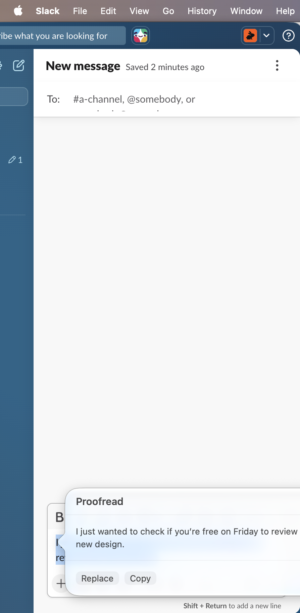
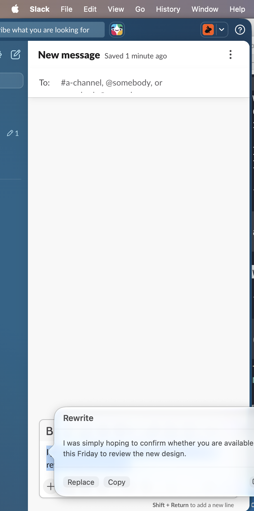

# &nbsp;Proofly

Proofread or rewrite selected text without leaving the app you’re writing in.

## Example in Slack

| Original draft | Proofread | Rewrite |
| --- | --- | --- |
|  |  |  |

## Install

1. [Download Proofly.zip for Apple silicon](https://github.com/Sayedfarazi/Proofly/releases/latest/download/Proofly.zip), unzip it, move **Proofly.app** to **Applications**, and open it.
2. If macOS says it can’t verify the developer and you trust the download, click **Done**. Go to **System Settings → Privacy & Security**, find Proofly under **Security**, and choose **Open Anyway**.
3. In **System Settings → Privacy & Security → Accessibility**, enable **Proofly**. This lets the shortcuts work with selected text in other apps.

## Default keyboard shortcuts

Proofly lives in the Mac menu bar and gives you two configurable keyboard shortcuts.

| Action | Default shortcut |
| --- | --- |
| Proofread spelling, grammar, and punctuation | Control–Option–Command–P |
| Rewrite for clarity and flow | Control–Option–Command–R |

<em>Look for the  icon in your Mac’s menu bar.</em>

To change a shortcut, click the Proofly icon in the menu bar and choose **Settings…**. Click the current shortcut next to **Proofread** or **Rewrite**, then press the new key combination. Press **Escape** to cancel.

## Use

Proofly invokes the app’s native Apple Writing Tools command when available. Native Writing Tools requires macOS 15.1 or later and an app that offers the command. The fallback requires macOS 26 or later with Apple Intelligence enabled and the on-device model available. It accepts up to 6,000 UTF-8 bytes per selection.

## Privacy

Proofly uses Apple’s Writing Tools. If Writing Tools aren’t available, Proofly uses Apple’s on-device model to revise the text on your Mac. Proofly doesn’t save a history of your text or ask for an account or API key.

## Credits and license

Copyright © 2026 Sayed Farazi. All rights reserved.

Apple, Mac, and macOS are trademarks of Apple Inc., registered in the U.S. and other countries and regions. Apple Intelligence is a trademark of Apple Inc.
